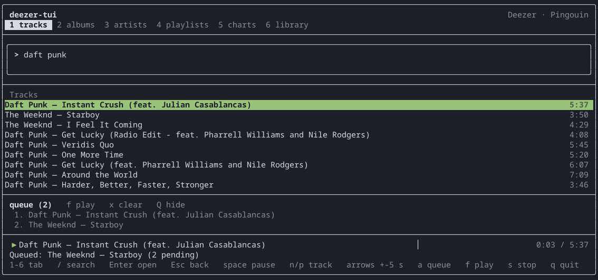

# deezer-tui

**A Deezer client for the terminal.** Keyboard-driven, written in C++20 with
[FTXUI](https://github.com/ArthurSonzogni/FTXUI), playing through libmpv.

[](https://github.com/Mordelia/deezer-tui/actions/workflows/build.yml)
[](LICENSE)
[](#requirements)
[](#requirements)



## Features

- **Search** the whole catalogue — tracks, albums, artists, playlists — plus the
  public charts. No account needed for any of it.
- **Playback** in MP3 128, MP3 320 or FLAC, with pause, next/previous, seeking
  and automatic chaining.
- **Queue** tracks from any list and play them back in order.
- **Your library**: playlists (private ones included), favourite albums,
  favourite artists and loved tracks.
- **Family profiles**: switch between the profiles of a Family subscription
  without reconnecting, and without touching your session.
- **Desktop integration**: publishes itself over MPRIS, so bars and shells
  (Caelestia, Waybar, `playerctl`...) show the current track and can control it.
- **Nothing touches the disk**: audio is decrypted as a stream and never
  written anywhere.

## Requirements

- Linux (uses `libsystemd` for MPRIS and XDG paths)
- A C++20 compiler (GCC 13+ or Clang 16+)
- CMake 3.20+
- `libcurl`, `nlohmann-json`, `openssl`, `libmpv`, `libsystemd`

FTXUI 7.0.3 is downloaded and built automatically by CMake, so there is no
system package to install for it. The first build takes about a minute; later
ones are fast.

## Install

### Arch Linux

```sh
sudo pacman -S --needed base-devel cmake curl nlohmann-json openssl mpv systemd-libs
```

### From source

```sh
git clone https://github.com/Mordelia/deezer-tui.git
cd deezer-tui
cmake -S . -B build -DCMAKE_BUILD_TYPE=Release
cmake --build build -j"$(nproc)"
```

The binary is `build/deezer-tui`.

## Configuration

Search and charts work out of the box. Playback, the library and private
playlists need the session cookie of your Deezer account — the **ARL**.

1. Open [deezer.com](https://www.deezer.com) in a browser, open the developer
   tools, go to *Application → Cookies → `deezer.com`*, and copy the value of
   the `arl` cookie.
2. Write it to the configuration file:

```sh
mkdir -p ~/.config/deezer-tui
cat > ~/.config/deezer-tui/config <<'EOF'
arl=your_cookie_here
# optional: MP3_128, MP3_320 or FLAC
format=MP3_320
EOF
chmod 600 ~/.config/deezer-tui/config
```

The file is read from `$XDG_CONFIG_HOME/deezer-tui/config`, falling back to
`~/.config/deezer-tui/config`. It uses a strict subset of the `.env` syntax:
`KEY=value`, `#` comments, optional surrounding quotes. Unknown keys raise a
warning, which makes typos easy to spot.

`--show-config` prints what was actually loaded, with the ARL redacted.

### Environment variables

| Variable             | Effect                                                  |
|----------------------|---------------------------------------------------------|
| `DEEZER_ARL`         | ARL, takes precedence over the configuration file       |
| `DEEZER_FORMAT`      | Audio format, takes precedence over the file            |
| `DEEZER_MPV_OPTIONS` | Extra mpv options, separated by `;` (`ao=null;volume=50`) |
| `DEEZER_MPV_DEBUG`   | Relay mpv logs and seek traces to stderr                |

The ARL is never logged, and the configuration file is never rewritten by the
application.

## Usage

```sh
./build/deezer-tui                 # the interface
./build/deezer-tui --play 3135556  # play a track, without the interface
./build/deezer-tui --self-test     # check the crypto layer (offline)
./build/deezer-tui --show-config   # print the loaded configuration
./build/deezer-tui --help
```

### Key bindings

| Key                | Action                                              |
|--------------------|-----------------------------------------------------|
| `1` … `6`          | Tracks, albums, artists, playlists, charts, library |
| `/`                | Focus the search field                              |
| `Enter`            | Run the search / play / open                        |
| `Escape`           | Go back one level                                   |
| `space`            | Pause / resume                                      |
| `←` `→` or `h` `l` | Rewind / forward 5 s                                |
| `n` / `p`          | Next / previous track                               |
| `a`                | Queue the selected track                            |
| `f`                | Play the queue                                      |
| `x`                | Clear the queue                                     |
| `Q`                | Show / hide the queue                               |
| `s`                | Stop playback                                       |
| `j` / `k`          | Move down / up the list                             |
| `q`                | Quit (only outside the search field)                |

The list has focus at startup, so `q` quits immediately. Characters are only
treated as shortcuts while the search field does not have focus.

## How it works

The interface is a stack of views rendered by FTXUI, fed by two worker threads
(one for loading, one for playback) that never block the UI thread. Audio comes
from Deezer's CDN, is decrypted on the fly, and is handed to a single persistent
libmpv process through a custom `dzr://` stream protocol.

The interesting parts — the session cookies the private API demands, the
Blowfish stripe mode, block-aligned seeking, the producer/consumer buffer that
made seeking hang, and the MPRIS property flag that silently swallowed every
signal — are written up in **[docs/INTERNALS.md](docs/INTERNALS.md)**.

## Contributing

Issues and pull requests are welcome. Please keep the build clean — it is
compiled with `-Wall -Wextra -Wpedantic` and warnings are treated as bugs.

```sh
cmake -S . -B build -DCMAKE_BUILD_TYPE=Debug
cmake --build build -j"$(nproc)"
./build/deezer-tui --self-test
```

## License

[MIT](LICENSE).

## Disclaimer

This is an unofficial client. It talks to Deezer's private API using your own
session cookie, for strictly personal use, and is not affiliated with or
endorsed by Deezer. No audio is stored or redistributed; everything is streamed
and decrypted in memory.
